# Forecasting California Retail Gasoline Prices 1–12 Weeks Ahead
### What the 2026 crude shock teaches about seasonality, crude pass-through and California's premium

UCLA Anderson MSBA · Time Series Analysis & Forecasting (Dr. William Yu) · Group Project, October 2026

---

## Executive summary

**Question.** Can we forecast California's average retail gasoline price 1–12 weeks ahead, and what drives it?

**Why it matters.** California drivers paid **$6.23/gal** in the week of October 5, 2026. That is **$1.87 more than the US average**, and the price is up 54% since the first week of January. Brent crude roughly doubled in 2026: from about $62 in December 2025 to $138 in April, then back to about $70 in June and to $135 in early October. A reliable 1–12-week outlook helps three groups:
- households and fleets budgeting fuel costs;
- retailers managing margins and inventory;
- the state, which now regulates refiner margins and monitors price spikes.

**Approach.**
- **Data:** eight public EIA series — CA and US retail gasoline, Brent and WTI crude, West Coast (PADD5) and US gasoline inventories, and refinery utilisation — built into a weekly panel aligned on each Monday price date.
- **No look-ahead:**
  - Crude enters with its prior-Friday close.
  - Inventory and utilisation data enter only once EIA has released them (10 days after the reference week).
  - An automated test rebuilds the panel from truncated data at 26 origins and confirms identical features.
- **Models compared (13):** random walk, seasonal naive, a 10-year seasonal mean, ARIMA(3,1,2), damped-trend ETS, direct multi-horizon Ridge and gradient-boosting regressions (with and without a seasonal-expectation feature), and four equal-weight ensembles.
- **Backtest:** weekly from January 2022, with an expanding window and refits every 4 weeks.
- **Selection:** the top model was chosen on 2022–24 targets only, then judged on an untouched 2025–26 holdout.

**Findings.**
1. **Seasonality is the single strongest signal.** Prices rise from February to May and fall from October to December. A 10-year seasonal mean alone cuts 12-week RMSE by 22–24% relative to a random walk.
2. **The top model is an equal-weight ensemble of Ridge and gradient boosting, both using the seasonal feature** ("Ens: ML (+seasonal)"). On the 2025–26 holdout it beat the random walk at every horizon:

   | Horizon | Holdout MAE (top model) | Holdout MAE (random walk) | RMSE vs random walk | DM test vs RW |
   |---|---|---|---|---|
   | 1 week | **$0.056** | $0.078 | 0.81 (−19%) | p = 0.005 |
   | 4 weeks | **$0.206** | $0.234 | 0.89 (−11%) | p = 0.24 |
   | 8 weeks | **$0.303** | $0.362 | 0.83 (−17%) | p = 0.17 |
   | 12 weeks | **$0.342** | $0.458 | 0.82 (−18%) | p = 0.15 |

   It also called the direction of change correctly 71–79% of the time. The 1-week gain is statistically significant; the longer-horizon gains are consistent in sign but not significant on 2025–26's ~90 overlapping errors.
3. **Drivers.** After seasonality, the largest effects are:
   - recent CA price momentum;
   - Brent's 4-week change, which is passed through with a lag;
   - the retail-minus-crude margin, where unusually wide margins compress over the next 1–3 months;
   - California's premium over the US, which mean-reverts.

   A 10% Brent move feeds through to about **24¢/gal by week 8**, roughly 75% of full mechanical pass-through.
4. **Shocks change the ranking but don't break the models.** In the 2026 shock, errors were about twice those of 2023–25. Every key model still beat the random walk. The plain seasonal mean was the best performer at 4–12 weeks, because crude momentum reversed twice.
5. **Forecast.** From $6.23 on October 5, the top model expects prices to hold near $6.17–6.24 through mid-November and then ease seasonally:

   | Target date | Forecast | 80% interval | 90% interval |
   |---|---|---|---|
   | Nov 2, 2026 | **$6.17** | $5.79–6.65 | $5.72–6.92 |
   | Dec 28, 2026 | **$5.58** | $4.99–6.58 | $4.87–7.06 |

   The intervals come from the model's own backtest errors. On the holdout, bands built from 2022–24 errors covered 78–88% (80% band) and 86–95% (90% band) of outcomes.

**Caveat.** The forecast assumes the seasonal autumn decline reasserts itself. With Brent having jumped 18% on October 2, the upside tail of the band deserves weight. Our scenario tool shows that a further +20% Brent move would leave December prices near $6.02 rather than $5.62. That figure comes from the Ridge driver model, whose baseline differs slightly from the ensemble's.

**AI component.** We built both options:
- **Option B:** an interactive **Streamlit dashboard** (`app.py`) with driver history, model and horizon pickers, backtest views, accuracy tables, the forecast fan and a Brent ±X% scenario slider.
- **Option A:** an **LLM-forecast benchmarking kit** (`llm_kit.py`). It gives an LLM exactly the data a forecaster had at each of 20 origins and scores its answers with the same metrics. Seven of the origins fall after the model's knowledge cutoff, which controls for training-data contamination.

Claude Code was used as a pair programmer throughout (Section 8).

---

## 1. Motivation

Gasoline is the most visible price in the California economy. It feeds directly into household budgets, delivery and ride-hail costs, and inflation expectations. In 2026 it also became a policy story: the crude shock pushed California's average above $5.90 in May and to $6.23 by October.

California's price differs from the rest of the country for structural reasons:
- its special cleaner-burning blend (CARBOB);
- the highest state fuel taxes and cap-and-trade and low-carbon-fuel costs;
- a refining market that is nearly isolated from the rest of the US.

The isolated market means that when a West Coast refinery stumbles, there is little spare supply to fill the gap.

Our project asks two questions:
1. **Forecasting.** How well can we predict the CA price 1, 4, 8 and 12 weeks ahead, compared with the naive benchmark of "next week's price = this week's price"?
2. **Explanation.** Which observable drivers move the price — crude, margins, the CA–US premium, inventories, refinery utilisation, the calendar — and how much of a crude shock reaches the pump, and how quickly?

The 2022 Russia–Ukraine spike and the 2026 crude shock give us two natural stress tests inside our evaluation window.

## 2. Data

All data are public U.S. Energy Information Administration (EIA) series, downloaded as CSVs.

| Series | Frequency (day) | Coverage | Notes |
|---|---|---|---|
| CA retail regular gasoline | Weekly (Mon) | May 2000 – Oct 5, 2026 | **Target**; 1,377 weeks, no gaps; $1.10–$6.27 |
| US retail regular gasoline | Weekly (Mon) | Jan 2000 – Oct 5, 2026 | $1.06–$5.01 |
| Brent crude spot | Daily (Mon–Fri) | Jan 2000 – Oct 6, 2026 | 500 blank rows, all market holidays; $9.12–$143.95 |
| WTI crude spot | Daily | Jan 2000 – Oct 6, 2026 | 649 blanks, including the April 2020 negative print; not used in models |
| PADD5 gasoline stocks | Weekly (Fri) | 1990 – Oct 2, 2026 | West Coast inventories, thousand bbl |
| US gasoline stocks | Weekly (Fri) | 1990 – Oct 2, 2026 | |
| PADD5 refinery utilisation | Weekly (Fri) | **Jun 2010** – Oct 2, 2026 | Limits the regression sample to mid-2010 onward |
| US refinery utilisation | Weekly (Fri) | 1990 – Oct 2, 2026 | Shown in the app only |

The full profile is in `outputs/data_profile.csv`. The weekly series have no missing weeks, and every crude blank is a holiday, which we drop.

### 2.1 The weekly panel and the "no look-ahead" rule

All data are indexed on the **Monday retail-price date T**, which is our forecast origin. Each input is aligned to what was actually published by Monday T:

- **Crude:** the last daily close on or before the **prior Friday** (T − 3 days).
- **Inventories and utilisation:** EIA publishes the week ending Friday F on the following Wednesday, so we use it only from **Monday F + 10**. At origin T the newest stock reading is therefore 10–16 days old.

**Features**, all known at T:

| Feature | Definition |
|---|---|
| CA momentum | ln CA change over 1 and 4 weeks |
| Brent momentum | ln Brent change over 1, 4 and 12 weeks |
| Margin deviation | (CA − Brent/42) minus its trailing 52-week mean |
| Premium deviation | (CA − US) minus its trailing 52-week mean |
| Inventory deviation | PADD5 and US stocks, % above or below the same week's average of the prior 5 years |
| Refinery utilisation | PADD5 level and 4-week change |
| Calendar | sin and cos of week-of-year |
| **Seasonal expectation** `seas_h` | Average ln change over the next *h* weeks at this week-of-year across the **prior 10 calendar years** (at least 5 required) |

**Target:** `tgt_h = ln CA(T+h) − ln CA(T)` for h = 1…12.

**Look-ahead test.** `check_no_lookahead()` re-creates the panel from raw files truncated to each origin's publication cut-off at 26 random and recent origins. It requires every feature to be identical to the full-sample panel, and all 26 match exactly. To test the test, we injected a leak by aligning EIA data with a 3-day lag instead of 10, and the check correctly failed.

## 3. The story in the data

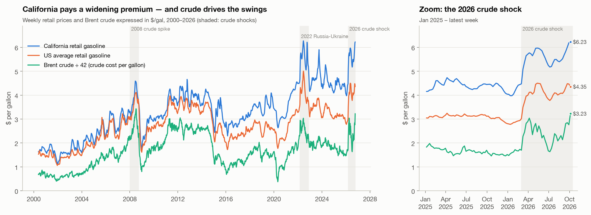
*Figure 1. CA and US retail prices with Brent expressed in $/gal (÷42), so all three share one axis. The gap between the retail and crude lines is the retail margin, which covers taxes, refining, distribution and retail.*

**The 2026 crude shock.** Brent averaged $62.5 in December 2025 and $71 in February 2026. It then jumped to $96 by March 9 and peaked at $138 on April 7. California's price rose from $4.47 to $5.77 in five weeks, peaked at $5.97 in mid-May, and slid to $5.18 by early July as Brent fell back toward $70. A second surge in September took Brent from about $96 to $135 on October 2, and CA gasoline back to a new 2026 high of **$6.23**.

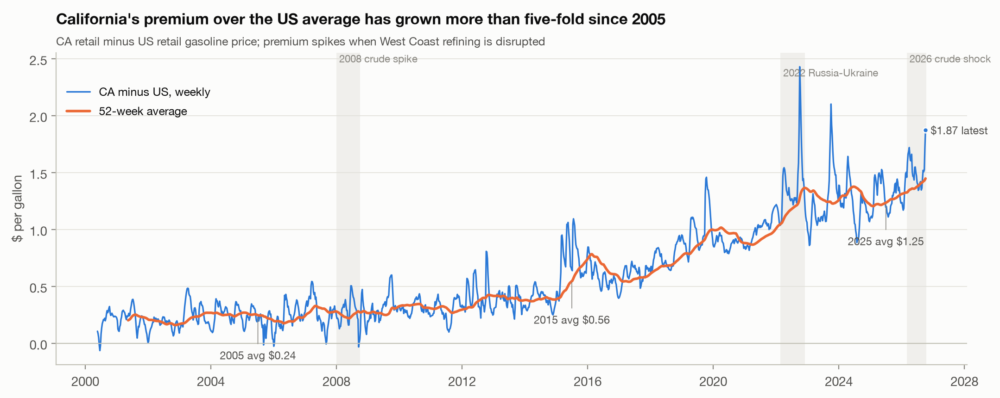
*Figure 2. California's premium over the US average.*

**California's premium.** The CA–US gap averaged about **$0.20 in 2005** and **$1.31 in 2025**, and was $1.48 so far in 2026, reaching $1.87 in the latest week. It rose in steps:
- 2015, after the Torrance refinery explosion;
- 2019–2022, as refinery closures and conversions shrank in-state capacity and the low-carbon fuel and cap-and-trade programmes tightened.

Its spikes, such as autumn 2022 and autumn 2023, line up with West Coast refinery outages, not with crude. This is why we include the premium's deviation from its own 52-week trend as a mean-reverting feature.

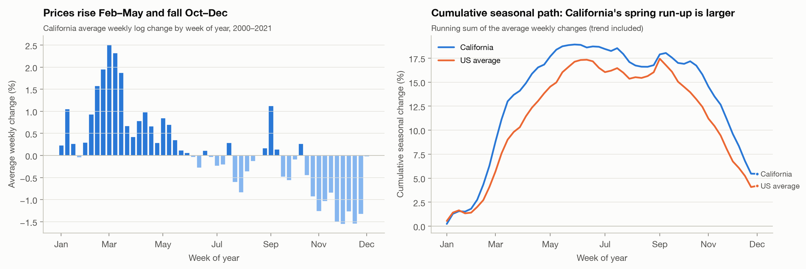
*Figure 3. Average weekly log change by week of year, 2000–2021 (left), and its running sum (right).*

**Seasonality.** CA prices rise in a concentrated burst from February to May, about +17–19% cumulatively, including trend. Two things drive it: spring refinery maintenance and the switch to the costlier summer blend. Prices then drift lower from October to December, when the cheaper winter blend returns and demand falls. California's spring run-up is larger than the nation's. Seasonality was the strongest signal in our first pass: a seasonal benchmark beat most of our early models. So we turned it into an explicit, leakage-free feature, the 10-year average change over the coming *h* weeks.

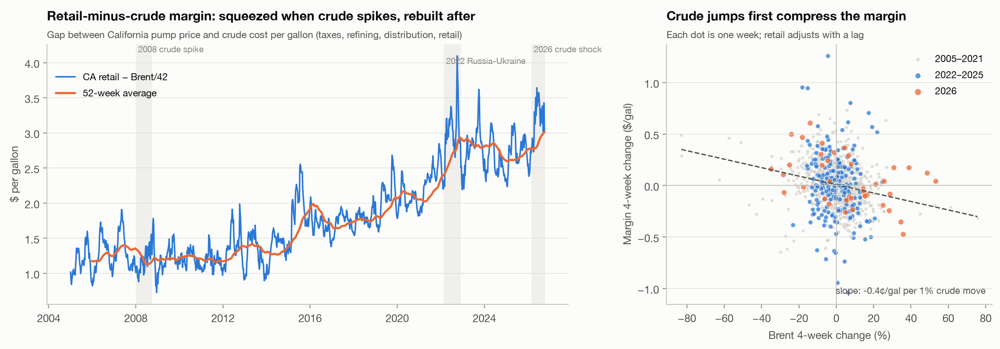
*Figure 4. Retail-minus-crude margin (left) and its 4-week change against Brent's 4-week change (right).*

**Pass-through is lagged.** When Brent jumps, the margin is squeezed first, because the pump price lags crude. Each 1% crude move compresses the margin by about 0.4¢ over four weeks, and the margin is rebuilt in the following weeks ("rockets and feathers"). As a result, a wide margin today predicts falling prices, and a squeezed margin predicts rising prices. The margin deviation has a −0.37 correlation with the next 4-week change (Figure 6).

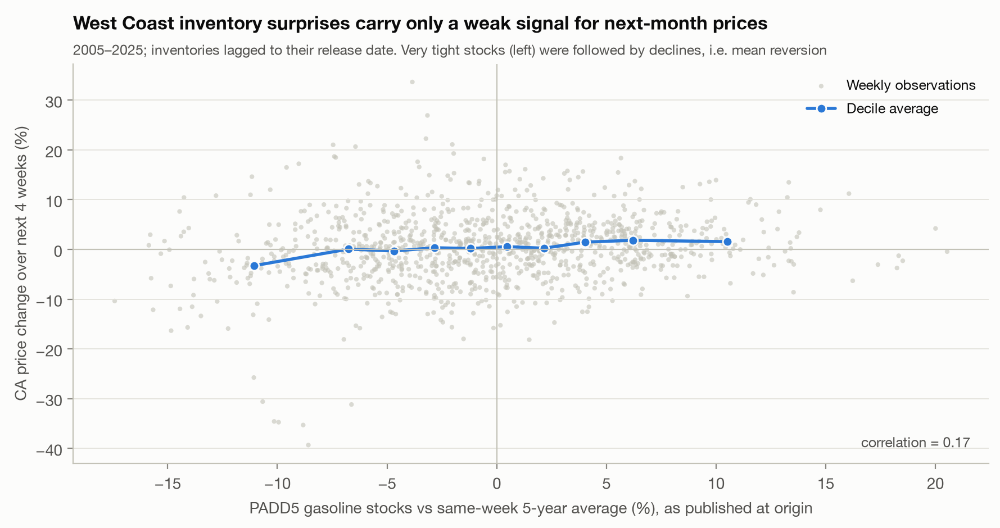
*Figure 5. West Coast inventory deviation (as published at the origin) against the following 4-week CA price change.*

**Inventories carry a weak signal.** We expected tight inventories to predict rising prices. The relationship is weak (correlation 0.17) and, at the extremes, runs the other way: the tightest-stock weeks were followed by declines, as the outages that drained stocks were resolved. Part of the correlation is also seasonal, because stocks are seasonally high just before the spring run-up. We keep the feature for completeness, but it ranks low in importance (Figure 10).

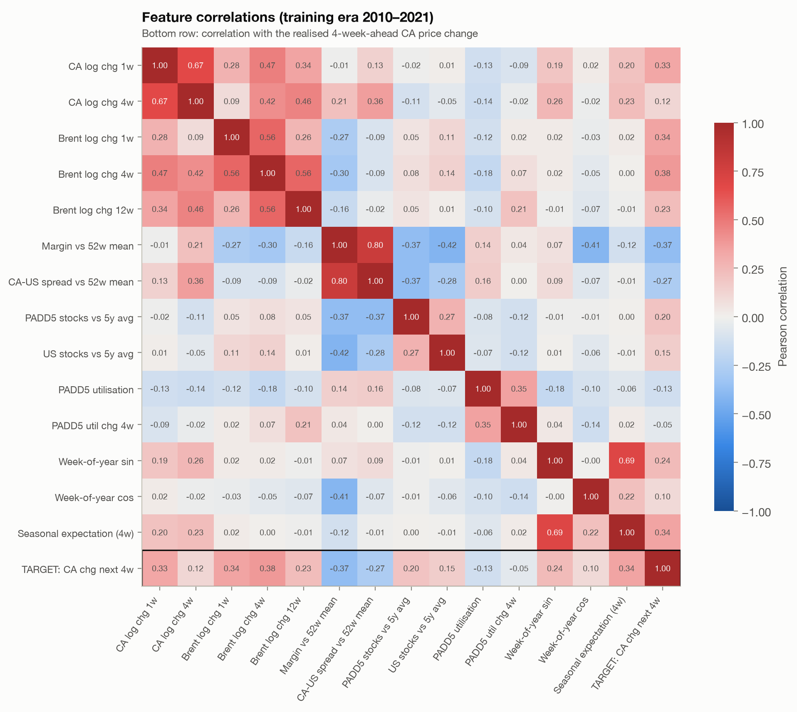
*Figure 6. Feature correlations, 2010–2021. The bottom row is correlation with the realised 4-week-ahead CA change.*

## 4. Methods

### 4.1 Models

All models forecast the **log change** from the origin price for h = 1…12, which is converted back to $/gal for scoring.

| Model | Specification | Why include it |
|---|---|---|
| **Random walk** | ŷ(T+h) = y(T) | The benchmark every forecaster must beat |
| **Seasonal naive** | y(T) + [y(T−52+h) − y(T−52)], last year's change over the same weeks | Classic seasonal benchmark, applied to changes because the level trends |
| **Seasonal mean (10y)** | y(T) + `seas_h` | Averages ten seasons, which is much less noisy than one |
| **ARIMA(3,1,2)** | Log price. Order chosen by AIC over p, q ≤ 3, with and without drift, **on data to Dec 2021 only** (`outputs/arima_order_selection.csv`) | Standard univariate time-series model |
| **ETS damped** | Holt additive damped trend on log price | Exponential-smoothing benchmark |
| **Ridge** / **Ridge + seasonal** | One regression per horizon (*direct* strategy) on the features, standardised, with α chosen by RidgeCV | Interpretable driver model; also powers the scenario tool |
| **GBM** / **GBM + seasonal** | Gradient boosting, one model per horizon: 250 trees, depth 2, learning rate 0.03, subsample 0.8, seed 42 | Captures non-linear effects, e.g. the margin squeeze only mattering when large |
| **Ensembles** | Equal-weight average of member log-change forecasts. Members fixed *before* seeing results: (i) RW + seasonal mean; (ii) ARIMA + ETS + seasonal mean; (iii) Ridge+S + GBM+S; (iv) all nine individual models | Combining forecasts usually reduces variance |

**Why direct multi-horizon regressions?** A separate model for each h avoids compounding one-step errors. It also lets the importance of each driver change with the horizon. For example, the seasonal effect grows steadily from h = 1 to h = 12 (Figure 10).

### 4.2 Validation design

- **Rolling origin, expanding window.** We use every Monday from January 3, 2022 to October 5, 2026: 249 origins × 13 models × 12 horizons, about 38,800 forecasts. Each model is re-estimated every 4 weeks using all data up to that origin. Between refits, the latest data are fed through the fixed parameters; ARIMA and ETS re-filter their states.
- **No target leakage in training.** For horizon h at origin T, the regressions train only on rows whose *target date* t + h ≤ T. This is asserted in code.
- **Choose on validation, report on holdout.** Forecasts are grouped by **target date**:
  - **2022–2024 (validation)** is used to rank models. The criterion is mean RMSE relative to the random walk over h = 1, 4, 8, 12.
  - **2025–2026 (holdout)** is reported separately and played no part in any choice.
- **Regimes.** We also report three regimes by target date: the 2022 spike (2022), 2023–25 normal, and the 2026 shock (2026).
- **Metrics.**
  - MAE and RMSE in $/gal.
  - MAPE in %.
  - Directional accuracy: the share of forecasts that got the sign of the change right; undefined for the random walk.
  - RMSE relative to the random walk.
  - **Diebold–Mariano** tests against the random walk: squared-error loss, Newey–West variance with h−1 lags for overlapping errors, and the Harvey–Leybourne–Newbold small-sample correction.
- **Prediction intervals.** At each horizon, we take the empirical 10/90% and 5/95% quantiles of the top model's backtest log errors (ln actual − ln forecast) and apply them around the point forecast. We check honesty by building the bands from 2022–24 errors only and measuring their coverage on 2025–26.

## 5. Results

### 5.1 Model selection on 2022–24 (validation)

| Model | Mean RMSE vs RW, validation | Mean RMSE vs RW, holdout |
|---|---|---|
| **Ens: ML (+seasonal)** | **0.807** | 0.837 |
| GBM + seasonal | 0.814 | 0.853 |
| GBM | 0.817 | 0.847 |
| Ridge + seasonal | 0.825 | 0.844 |
| Ens: all models | 0.827 | 0.844 |
| Seasonal mean (10y) | 0.836 | **0.833** |
| Ridge | 0.857 | 0.883 |
| Ens: statistical | 0.894 | 0.876 |
| Ens: RW + seasonal mean | 0.901 | 0.900 |
| ARIMA(3,1,2) | 0.918 | 0.923 |
| Random walk | 1.000 | 1.000 |
| ETS damped | 1.086 | 1.013 |
| Seasonal naive | 1.109 | 0.937 |

*Averages over h = 1, 4, 8, 12 (`outputs/model_ranking.csv`).*

The ML ensemble ranks first on validation and is therefore our top model. On the holdout its average is essentially tied with the much simpler 10-year seasonal mean (0.837 vs 0.833), and both are far ahead of ARIMA, ETS and the seasonal naive. The top model's advantage is concentrated at short horizons: at h = 1 its RMSE is 0.81× the random walk's, against 0.92× for the seasonal mean. The seasonal mean is slightly better at 8–12 weeks.

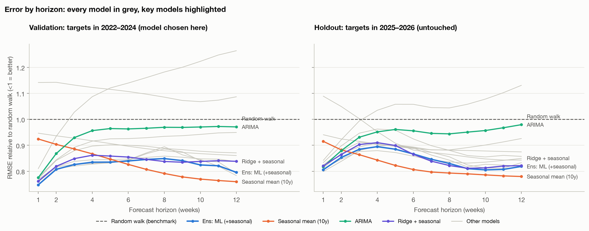
*Figure 7. RMSE relative to the random walk by horizon, for all 13 models (grey) with key models highlighted.*

**What the backtest says about each model family:**
- **ARIMA(3,1,2)** captures short-run momentum: it beats the random walk by 18–22% at h = 1. Its advantage disappears beyond about 4 weeks because it has no notion of season.
- **ETS damped** extrapolates trends and is *worse* than the random walk beyond about 3 weeks. Damped trends still overshoot at turning points.
- **Seasonal naive**, using only last year's pattern, is too noisy. One year's idiosyncratic outages get projected forward.
- **Adding the seasonal feature** helps Ridge (validation mean 0.857 → 0.825) and modestly helps GBM.

### 5.2 The top model on the untouched 2025–26 holdout

| h | MAE | RMSE | MAPE | Direction correct | RMSE vs RW | DM stat (p) |
|---|---|---|---|---|---|---|
| 1 | $0.056 | $0.091 | 1.13% | 79.3% | 0.806 | −2.89 (0.005) |
| 4 | $0.206 | $0.300 | 4.05% | 70.7% | 0.895 | −1.18 (0.24) |
| 8 | $0.303 | $0.430 | 5.95% | 73.9% | 0.830 | −1.40 (0.17) |
| 12 | $0.342 | $0.536 | 6.46% | 78.3% | 0.819 | −1.45 (0.15) |

*Random-walk holdout MAE for comparison: $0.078, $0.234, $0.362 and $0.458 at h = 1, 4, 8, 12.*

**Interpreting the DM tests.** The top model is better than the random walk at every horizon, and its validation-period DM p-values were 0.000 at h = 1, 0.013 at h = 4 and 0.08 at h = 8 and 12. On the holdout alone, only h = 1 is significant at 5%. A 21-month holdout contains only about 90 heavily overlapping 12-week errors, so the test has little power. Across validation and holdout, the improvement is consistent in direction and similar in size (15–25% vs 11–19% RMSE reduction).

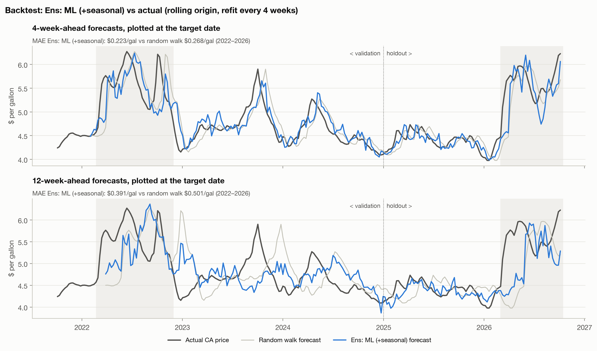
*Figure 8. Backtest of the top model at 4 and 12 weeks ahead, plotted at the target date, against the actual price and the random walk.*

Figure 8 shows the model's character. It anticipates the spring run-ups and autumn declines that the random walk misses, for example in 2023–25. But like every model, it cannot foresee the *onset* of a crude shock: March 2022 and March 2026 are missed at 12 weeks. It also overshoots the mean reversion after the May 2026 peak.

### 5.3 Regimes

| RMSE vs random walk (h = 4 / h = 12) | 2022 spike | 2023–25 normal | 2026 shock |
|---|---|---|---|
| **Ens: ML (+seasonal)** | 0.85 / 0.85 | **0.80 / 0.74** | 0.90 / 0.84 |
| Seasonal mean (10y) | 0.86 / **0.73** | 0.91 / 0.79 | **0.81 / 0.77** |
| Ridge + seasonal | 0.87 / 0.88 | 0.85 / 0.79 | 0.92 / 0.84 |
| ARIMA(3,1,2) | 0.97 / 1.05 | 0.96 / 0.92 | 0.92 / 0.98 |
| ETS damped | 1.11 / 1.47 | 1.08 / 1.11 | 0.98 / 1.11 |

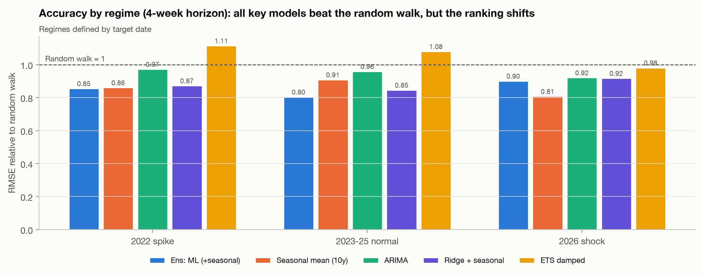
*Figure 11. Accuracy by regime at the 4-week horizon.*

- **Normal times (2023–25).** The driver-based ensemble shines here, cutting 12-week RMSE by 26%. Its 4-week MAE in 2023–25 was 15¢/gal.
- **Shocks.** Absolute errors roughly double: the 4-week MAE is 39¢ in 2022 and 32¢ in 2026. All key models still beat the random walk, except ETS and, at 12 weeks in 2022, ARIMA. But the ranking flips toward the simple seasonal mean. In 2026, crude momentum reversed sharply twice (April→June down, August→October up), and the momentum terms in Ridge and GBM chased each move. The seasonal mean ignores crude entirely, so it was not whipsawed.

### 5.4 Final 12-week forecast

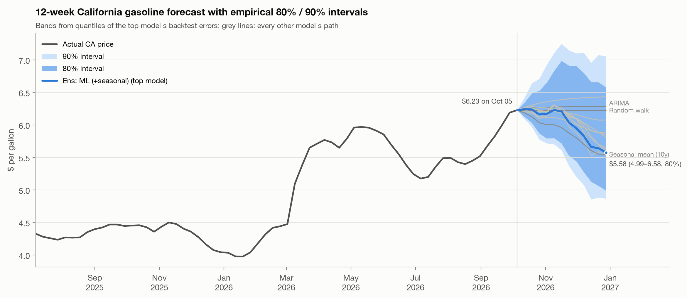
*Figure 9. The 12-week forecast from October 5, 2026, with empirical 80% and 90% bands. Every other model's path is shown in grey.*

| Week of | Forecast | 80% interval | 90% interval |
|---|---|---|---|
| Oct 12 | $6.24 | $6.13–6.34 | $6.09–6.42 |
| Oct 19 | $6.24 | $6.03–6.48 | $5.97–6.64 |
| Nov 2 | $6.17 | $5.79–6.65 | $5.72–6.92 |
| Nov 16 | $6.21 | $5.72–6.99 | $5.61–7.25 |
| Nov 30 | $5.95 | $5.44–6.90 | $5.20–7.10 |
| Dec 14 | $5.66 | $5.13–6.66 | $4.86–6.96 |
| Dec 28 | **$5.58** | $4.99–6.58 | $4.87–7.06 |

*Full table: `outputs/final_forecast_top_model.csv`.*

**Reading the forecast.**
- **Through mid-November:** the model expects prices to hold at about $6.20. Brent's October 2 jump to $135 (+17% on the week, +82% over 12 weeks) pushes up, while an unusually wide CA premium ($1.87 vs a 52-week norm of $1.45) and the start of the autumn seasonal decline push down.
- **After mid-November:** seasonality dominates, and prices ease toward $5.60 by late December.
- **Model disagreement:** the paths disagree on the destination. The seasonal mean, both GBMs and the ML ensemble end at $5.53–5.62. Ridge without the seasonal feature ends at $5.81. ARIMA and ETS, which have no season, stay at $6.28–6.43.
- **Skewed bands:** the bands are right-skewed, because historical errors were dominated by upside surprises.
- **Band coverage:** on the holdout, bands built from 2022–24 errors alone covered 78–88% of outcomes (nominal 80%) and 86–95% (nominal 90%). They were slightly conservative at middle horizons, and the 90% band was slightly short at 10–12 weeks.

## 6. What drives California gasoline prices?

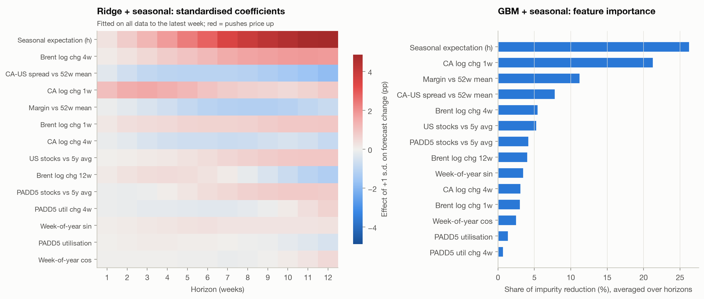
*Figure 10. Ridge + seasonal standardised coefficients by horizon (left), and GBM + seasonal feature importance (right). Both are fitted on all data to the latest week.*

Both the linear and the tree model tell the same story:
1. **Seasonal expectation.** This is the largest effect, and it grows with the horizon. A one-standard-deviation higher seasonal expectation adds 1.8 pp to the 4-week forecast change and 4.9 pp to the 12-week change.
2. **Recent CA momentum** (1-week change) dominates the short horizons. Retail prices adjust over several weeks, so last week's move tends to continue.
3. **Crude pass-through.** Brent's 1- and 4-week changes push the forecast up with a lag that peaks around 8–12 weeks. The 12-week change carries a small negative weight at long horizons: after a long crude run-up, part of the pass-through has already happened.
4. **Margin and premium deviations mean-revert.** When the CA–US premium is above its 52-week norm, or the retail-minus-crude margin is unusually wide, prices fall over the following 1–3 months.
5. **Inventories and refinery utilisation** add little once the variables above are known. Refinery problems show up faster and more completely in the premium and the margin than in lagged weekly stock data.

**Scenario: how much of a crude shock reaches the pump?** We use the Ridge driver model as if Brent had moved X% in the latest week. All Brent change features shift by ln(1+X), and the margin falls by Brent·X/42 because the pump has not yet moved. The model is linear in log changes, so the pass-through is nearly symmetric.

| Brent move | +1 week | +4 weeks | +8 weeks | +12 weeks | Full pass-through |
|---|---|---|---|---|---|
| ±10% | +4 / −4¢ | +16 / −16¢ | +24 / −25¢ | +20 / −21¢ | ±32¢ |
| ±20% | +7 / −8¢ | +30 / −33¢ | +48 / −50¢ | +39 / −43¢ | ±65¢ |

About half of a crude move reaches the pump within a month and about three-quarters by two months. The effect then fades slightly as margins normalise. This matches the lagged pass-through pattern in Figure 4. The Streamlit app exposes this scenario as a slider.

## 7. Limitations

- **Shocks are unforecastable from these data.** The models learn how prices *respond* to crude moves, not when geopolitics will cause them. Point forecasts during the onset of a shock are poor for every method. Use the intervals, and the scenario tool, as the main communication device during shocks.
- **Short holdout, overlapping errors.** 2025–26 provides only about 90 independent-ish 12-week errors. Beyond 1 week, holdout DM tests lack power, so the evidence for long-horizon gains rests on validation and holdout agreeing.
- **Small differences at the top.** The top five models are within 0.02 of each other on validation. A different selection metric, such as MAE, would favour the 10-year seasonal mean, which had the lowest validation MAE averaged over horizons. Our substantive conclusion — seasonality plus drivers beats the random walk by about 15–20% — does not depend on which of them is chosen.
- **The intervals assume the future resembles 2022–26.** That period was already unusually volatile, which is why the bands are wide. They are not conditional on the current crude regime.
- **Missing drivers.** Refinery outage reports, California-specific spot prices (LA CARBOB), regulatory changes (the 2023 SBX1-2 margin cap, LCFS credit prices) and taxes are not in the dataset. Adding CARBOB spot or refinery-outage indicators is the most promising extension.
- **Brent is the only crude benchmark used.** Brent was chosen because California refiners price off waterborne international crudes. WTI is loaded but not modelled.
- **The scenario tool is linear.** It assumes symmetric pass-through, whereas the "rockets and feathers" literature finds faster pass-through of increases. It also assumes the shock happens in the latest week, with no change to other features.

## 8. AI tools used and how

| Tool | Role |
|---|---|
| **Claude Code (Claude Opus 5.5)** | Pair programmer. It read the assignment brief and profiled the data, then implemented the pipeline in `src/`: the panel and the look-ahead test, the models, the backtest, the DM tests, the figures, the Streamlit app and the LLM kit. It also ran everything end to end and fixed errors. |
| **Streamlit app** (`app.py`, **Option B**) | Turns the analysis into a product: driver selector, model and horizon pickers, backtest viewer, accuracy table, forecast fan and a Brent scenario slider |
| **LLM forecast kit** (`llm_kit.py`, **Option A**) | Benchmarks an LLM *as a forecaster* against our models (below) |

**How we kept AI output honest.**
- We did not accept AI-generated code or claims uncritically. The look-ahead property is verified by an automated test, and the test itself is verified with a deliberately injected leak.
- Training-target dates are asserted to precede each forecast origin.
- All figures were rendered and inspected. One AI-drafted chart title ("tight inventories precede price increases") was **contradicted by the data** and was rewritten.
- Model choice was made on validation data only, with members of the ensembles fixed in advance.

**Option A design: "an honest LLM forecast."**
- **Twenty origins.** Thirteen fall between January 2025 and June 2026; seven fall *after* the model's stated knowledge cutoff (June 2026), between July 6 and September 28, 2026.
- **The prompt** contains the last 156 weeks of CA and US prices, prior-Friday Brent, and lagged PADD5 stocks and utilisation, built with the same truncation function that passed the look-ahead test. It asks for 1/4/8/12-week forecasts in JSON plus a short rationale.
- **API path:** with `ANTHROPIC_API_KEY` set, the kit calls Claude (`claude-opus-5-5`) with structured JSON output. Each origin is a fresh request with no memory, and the kit records which model actually served it.
- **Manual path:** without a key, prompts are saved for pasting into fresh chats with web search off.
- **Contamination control:**
  - For pre-cutoff origins, the LLM may simply *remember* the price path, so those scores are an upper bound on skill.
  - Only post-cutoff origins are a clean test.
  - A `--mask-dates` option relabels years (Y0, Y−1…) to make memorised prices harder to retrieve.
- **Scoring:** answers are scored with exactly the same metrics and DM tests as our models, at the same origins, against the random walk, seasonal mean, ARIMA and the top model (`outputs/llm/llm_scores.csv`, Figure 12 once responses exist).

> **Status:** prompts for all 20 origins are in `outputs/llm/prompts/`. *[Team: paste the LLM results table and Figure 12 here after running `python llm_kit.py score`.]*

---

### Reproducibility

`python analysis.py` regenerates every table and figure in about 4 minutes. `project.ipynb` runs the same steps with commentary, and `streamlit run app.py` launches the dashboard. Seeds are fixed (42). All outputs are in `outputs/`.

### References
- U.S. Energy Information Administration: *Weekly Retail Gasoline and Diesel Prices*; *Spot Prices for Crude Oil*; *Weekly Petroleum Status Report* (stocks, refinery utilisation).
- Diebold, F. X. & Mariano, R. S. (1995). Comparing predictive accuracy. *Journal of Business & Economic Statistics*, 13(3).
- Harvey, D., Leybourne, S. & Newbold, P. (1997). Testing the equality of prediction mean squared errors. *International Journal of Forecasting*, 13(2).
- Borenstein, S., Cameron, A. C. & Gilbert, R. (1997). Do gasoline prices respond asymmetrically to crude oil price changes? *Quarterly Journal of Economics*, 112(1).
- Hyndman, R. J. & Athanasopoulos, G. *Forecasting: Principles and Practice* (3rd ed.), OTexts.
